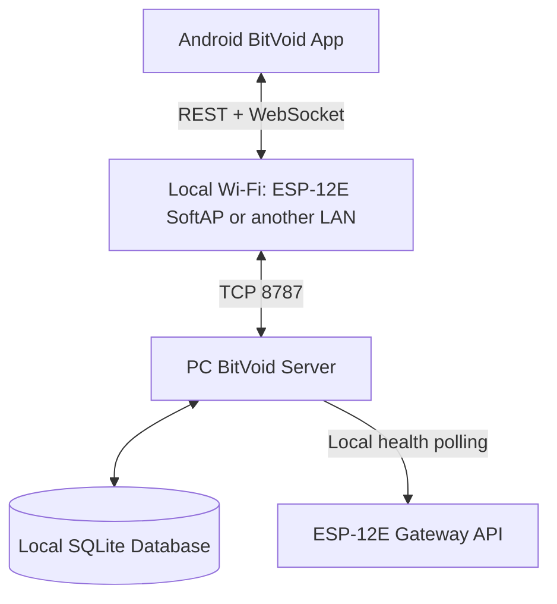

# BitVoid

BitVoid is an **Android-app-only, local-first communication system**. The native Android application is the only user-facing interface. There is no website, browser client, PC dashboard, ESP dashboard, WebView portal, or captive portal.

## Offline-first operation

BitVoid's core local services do not require Google, public internet access, or the cloud backend.

- The **ESP-12E** can create the local Wi-Fi access point.
- The **PC server** runs the main BitVoid application API, WebSocket service, pairing, and local SQLite storage.
- The **Android app** connects to the PC server over the local Wi-Fi network.
- **Cloud synchronization is optional and disabled by default**. It can be enabled later, but local messaging and local data storage must remain usable without it.

## Architecture

- **Android app** — the only user interface for pairing, local account setup, conversations, messaging, and other implemented native app features.
- **PC server** — local REST API, device pairing, SQLite persistence, WebSocket events, attachments, and optional authenticated cloud synchronization.
- **ESP-12E** — WPA2 Wi-Fi access point and lightweight discovery/health gateway. It does not host the application server or a user interface.
- **Cloud backend** — optional remote account and synchronization API. It is not required for local operation.

## Local communication flow



The ESP-12E default access point address is `192.168.4.1`. Connect the PC and Android phones to the same Wi-Fi network. The PC hosts the application API on port `8787`; the ESP does not relay application messages or replace the PC server.

The PC server binds to `0.0.0.0:8787`, advertises `bitvoid.local` through mDNS, and prints LAN-IP fallback URLs at startup. If mDNS is unavailable on a device, configure the app to use the PC's displayed LAN IP and port 8787.

## Local data and cloud separation

Local devices, users, conversations, and messages are stored in the PC server's SQLite database under `.state/bitvoid.sqlite` by default. The database remains local to the PC.

Cloud synchronization is explicitly opt-in:

```dotenv
BITVOID_CLOUD_SYNC_ENABLED=false
```

Leave this set to `false` for offline/local-only operation. To intentionally enable cloud synchronization, set it to `true`, configure `BITVOID_CLOUD_SYNC_URL`, and provide the registered PC server secret. Cloud unavailability must not prevent the local API from starting or local messages from being stored.

## PC server setup

Requires Node.js 22.13 or newer.

```powershell
cd pc-server
npm install
Copy-Item .env.example .env
# Edit .env and set a private ESP trust secret matching the ESP config.h
npm run check
npm start
```

The server listens on port 8787. Allow inbound TCP port 8787 through Windows Firewall for the Private network profile only. Do not expose this local HTTP/WebSocket service directly to the public internet.

Useful endpoints:

| Endpoint | Purpose |
|---|---|
| `GET /` | JSON service metadata |
| `GET /health` | Local process health |
| `GET /api/v1/health` | API health and optional cloud sync status |
| `GET /api/v1/gateway/info` | PC server capabilities |
| `GET /api/v1/services` | Available local services |
| `GET /api/v1/events` | Authenticated WebSocket event connection |

Application REST routes are under `/api/v1`. Pairing, account, conversation, messaging, and attachment routes are implemented in the PC server source. The private `/admin/api/*` routes are backend management APIs only; no dashboard UI is provided.

## ESP-12E setup

Open `esp12e-firmware/BitVoidESP12E/BitVoidESP12E.ino` in Arduino IDE.

1. Install the ESP8266 Arduino core and the libraries used by the sketch.
2. Copy `config.example.h` to `config.h`.
3. Set a unique WPA2 password (8–63 characters).
4. Set the gateway ID and PC server ID.
5. Set a unique ESP trust secret of at least 32 characters. It must match `BITVOID_ESP_TRUST_SECRET` in the PC server's private `.env`.
6. Upload the firmware and check the Serial Monitor at 115200 baud.

The ESP exposes machine-readable endpoints such as `/api/node`, `/api/v1/health`, `/api/v1/gateway/info`, and the authenticated `/api/v1/internal/status`. It does not provide messaging services; those run on the PC.

## Security

- Pair Android devices using the server's pairing challenge and administrator pairing code.
- Device tokens are stored as hashes by the PC server.
- Use a unique WPA2 password for the ESP access point.
- Use independent random secrets for ESP trust and cloud trust.
- Keep `.env` and `config.h` private and never commit real credentials.
- The ESP internal status endpoint verifies the configured PC server ID and trust secret.
- Keep the local server on a trusted private Wi-Fi network; local HTTP and WebSocket traffic are not public-internet transport.

## Project repositories

- Android application: https://github.com/nozaqk/BitVoid
- PC server and ESP-12E firmware: https://github.com/nozaqk/Bitvoid-Server
- Optional cloud API: https://github.com/nozaqk/BitVoid-Cloud-Backend-

## Development checks

Run `npm run check` in `pc-server` to perform Node.js syntax checks on the server modules. Compile the ESP sketch using the ESP8266 Arduino toolchain. Build and test the Android application from Android Studio or Gradle.

Hardware-level Wi-Fi, Android-to-PC, and ESP gateway tests require the actual PC, phone, and ESP-12E hardware.

No GitHub Actions workflows are used.
